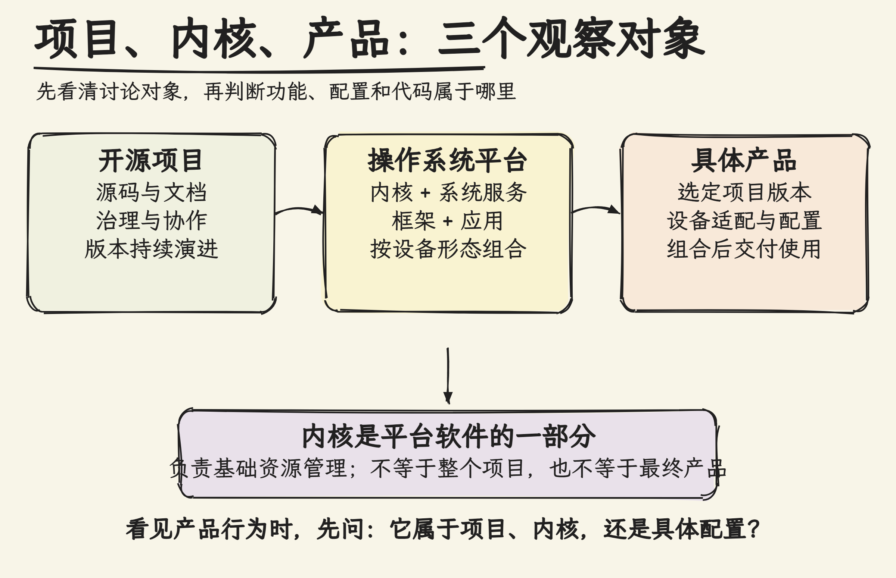
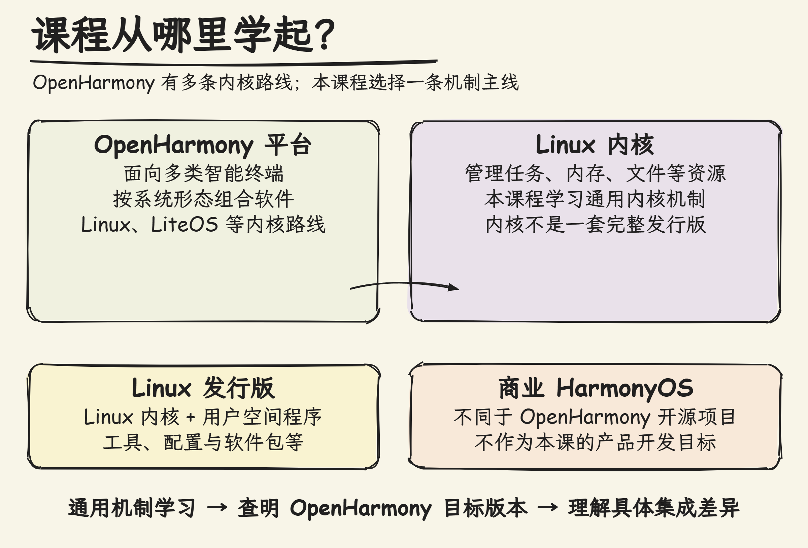

# Day001：我们要学习的 OpenHarmony 是什么？

## 摘要

我们学习的 OpenHarmony，究竟是一个内核、一套商品系统，还是一个开源项目？答案关系到怎样理解版本、代码和设备上的功能。本课区分三个观察对象：开源项目组织代码、文档和协作；内核是系统软件中管理基础资源的一部分；产品则把特定版本与设备适配、配置和上层软件组合起来。正文从熟悉的智能终端出发，用关系图拆开这些对象，再核对项目公开背景，说明官方资料能确认什么、不能据此推断什么。随后将 OpenHarmony 与 Linux 内核、Linux 发行版及商业 HarmonyOS 区分开，并说明课程选择 Linux 内核通用机制的理由：学习机制后，再针对 OpenHarmony 标准系统的具体版本研究集成差异。读完应能判断一个说法讨论的是项目、内核还是具体产品，也能解释“学习 Linux 内核”并不等于把 OpenHarmony 当成 Linux 发行版。

## 正文

### 从一个终端问题开始

一台设备能显示文字、管理文件，还能运行应用。听起来像一个整体，但你若要查“文件打不开”的原因，可能需要看应用、系统软件、内核，甚至设备配置。若把这些都叫作“操作系统”，就不容易说清问题发生在哪里。

先把观察对象分开。日常说的 OpenHarmony 可能指开源项目、项目提供的软件平台，或采用相关软件的设备产品。它们彼此有关，却不是同一个对象。

**开源项目**不只是一份可执行程序。它包括代码仓库、文档、版本发布和协作治理。项目把软件如何开发、评审和演进组织起来；具体运行时，用户看到的则是系统软件在设备上的组合效果。

**内核**是操作系统软件中的核心部分，负责管理处理器、内存、文件和设备等基础资源。它重要，但不是整个 OpenHarmony 项目：框架、系统服务、应用、文档和社区协作也不等于内核代码。

**产品**是落到具体设备上的组合。它采用某个软件版本，再结合硬件适配、系统配置和上层组件，形成用户实际使用的功能。因而某款设备有某项功能，不能直接推出所有 OpenHarmony 设备都有相同功能或配置。

### 开源项目怎样走到公开版本

OpenHarmony 官方项目概览将它定位为面向智能终端的开源操作系统项目，并说明由开放原子开源基金会孵化和运营。基金会为项目提供组织和运营环境；这不表示基金会亲自编写了所有组件，也不决定每款设备由谁制造。

官方发布说明记录 OpenHarmony 1.0 于 2020 年 9 月 10 日首次发布，并将这一版本标记为停止维护。这个事实说明项目有公开发布历史；它描述的是 1.0 版本，**不能据此断言整个 OpenHarmony 项目停止演进**，也不能把旧版当成当前学习或产品基线。

基金会项目目录当前把“开源鸿蒙”列在已毕业项目中，并显示华为终端有限公司为贡献方；该条目的捐赠方栏为空。这里的“贡献方”表示页面列出的贡献角色，不能替代代码产权或法律交易证明；空栏也只说明这次读取的页面没有列出捐赠方，不能推断历史上从未发生任何捐赠。

这类区分对读代码同样重要：代码公开、参与贡献、项目运营和产品交付是不同活动。遇到“整套代码捐赠”之类说法，应找正式一手材料确认具体对象和安排；当前资料未说明的细节，就不写成确定结论。

### OpenHarmony、Linux 与本课程范围

OpenHarmony 并非只有一条内核路线。官方概览列出 Linux 与 LiteOS 等选择，设备系统形态和资源约束会影响软件组合。选用哪条路线是系统方案的一部分，不代表某条路线天然适用于所有设备。

Linux **内核**管理基础资源；Linux **发行版**则通常把 Linux 内核与用户空间程序、工具、配置和软件包组合起来。用户空间指运行在内核之外的应用与系统程序。发行版不是内核本身，OpenHarmony 平台也不等同于任一 Linux 发行版。

商业 HarmonyOS 与 OpenHarmony 开源项目也要分开看。它们名称相似，但项目和产品定位不同；不能从商业产品的一项体验反推 OpenHarmony 所有设备都具备同样的软件或服务。

本课程选择 Linux 内核，是为了先学习进程、内存、文件访问等通用机制，再面向 OpenHarmony 标准系统的 Linux 路线阅读和验证。学会通用机制之后，仍需核对目标 OpenHarmony 版本、分支、配置和补丁；普通 Linux 发行版上的观察不能自动代表某个 OpenHarmony 产品。

所以“我们学 OpenHarmony 内核”不是说 OpenHarmony 只有内核，也不是从头开发一款消费产品。我们的路径是理解通用内核如何工作，再查明这些机制在目标系统里怎样配置、集成和测试。遇到新说法时，先问它谈的是开源项目、内核实现，还是某个具体产品；这个问题常能避免把局部事实误当成全局结论。

例如，本地文件读取失败，可能是应用路径写错、访问被拒绝，也可能涉及文件系统或设备适配；这些情形不能不经定位就概括为“OpenHarmony 项目出错”。先确定观察对象，才能找到相应源码、配置和责任层次。

本课依据：[OpenHarmony 项目概览](https://raw.githubusercontent.com/openharmony/docs/master/zh-cn/OpenHarmony-Overview_zh.md)、[OpenHarmony 1.0 发布说明](https://raw.githubusercontent.com/openharmony/docs/master/zh-cn/release-notes/OpenHarmony-1-0.md)和[开放原子开源基金会项目目录](https://www.openatom.org/projects)。这些页面会更新；1.0 发布说明标记为停止维护，基金会项目条目的空捐赠栏不证明历史交易不存在。核验记录见[官方资料索引](../../04_资料索引/官方资料索引.md)。
